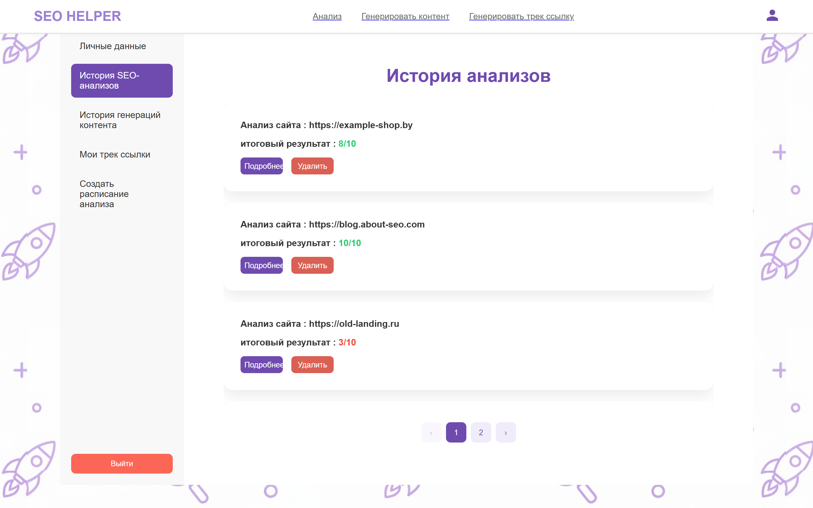
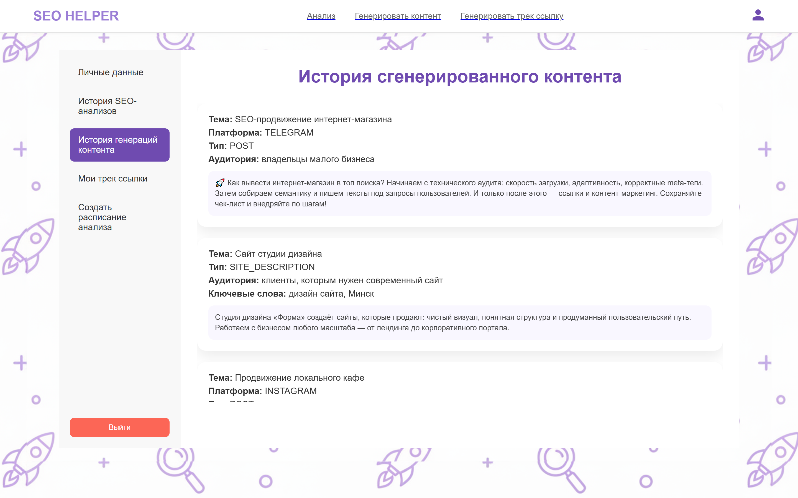
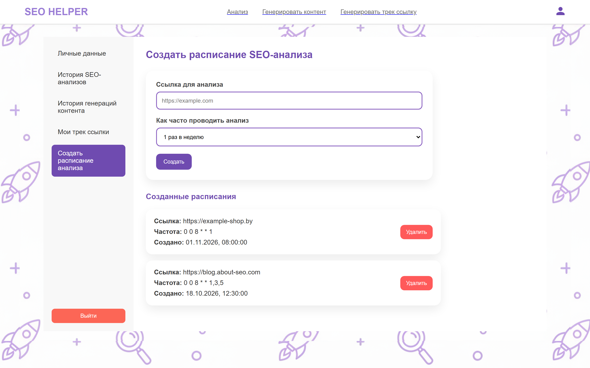
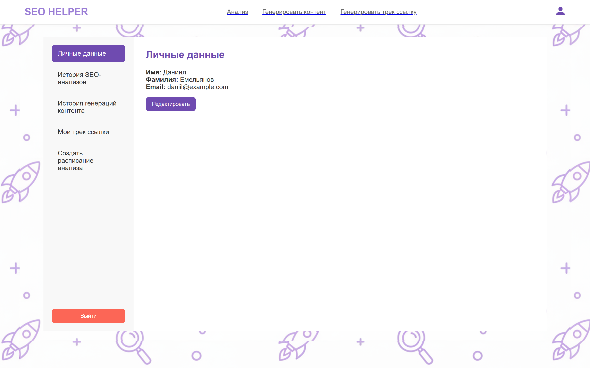
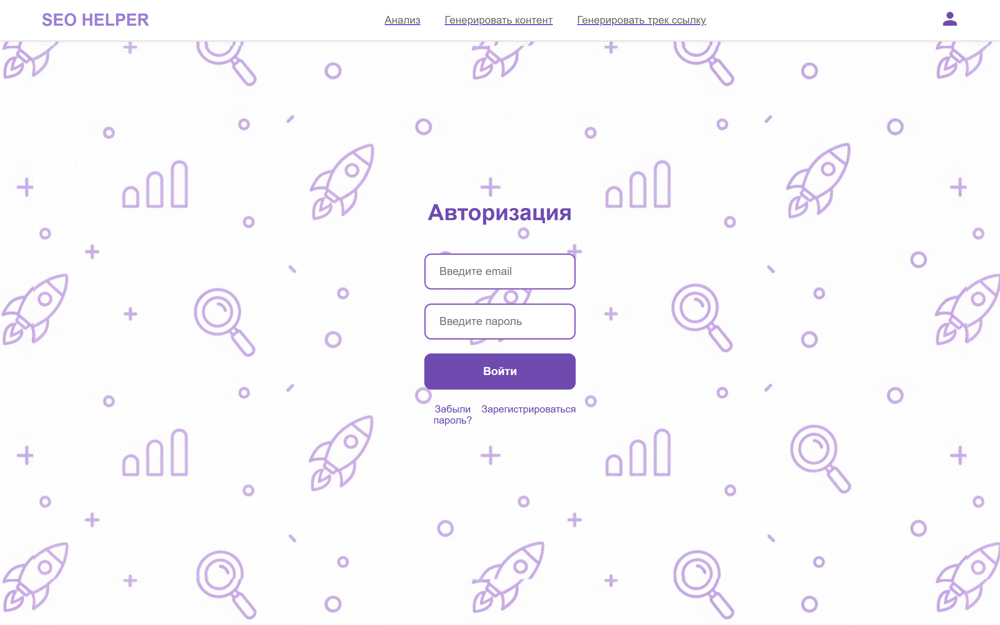
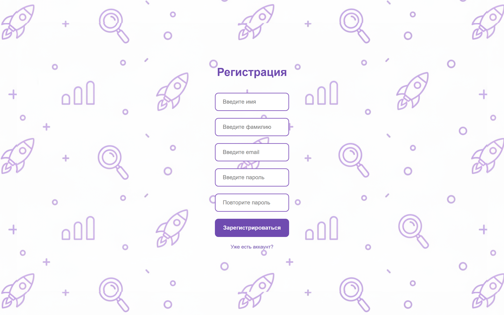
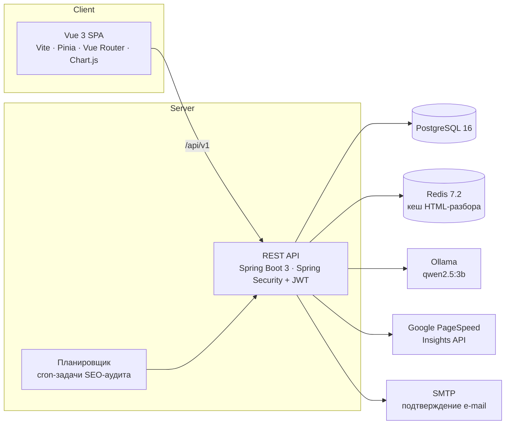

# SEO Helper

**Веб-платформа для SEO-аудита сайтов, генерации контента с помощью локальной LLM и аналитики переходов по коротким ссылкам.**

<p>
  
  
  
  
  
  
  
  
</p>

<p align="center">
  
</p>

---

## Содержание

- [Возможности](#возможности)
- [Скриншоты](#скриншоты)
- [Архитектура](#архитектура)
- [Технологии](#технологии)
- [Структура проекта](#структура-проекта)
- [Быстрый старт (Docker)](#быстрый-старт-docker)
- [Локальная разработка](#локальная-разработка)
- [Переменные окружения](#переменные-окружения)
- [API](#api)
- [Модель данных](#модель-данных)
- [Безопасность](#безопасность)
- [Тесты](#тесты)
- [Известные ограничения и планы](#известные-ограничения-и-планы)

---

## Возможности

| | Возможность | Что делает |
|---|---|---|
| 🔍 | **SEO-аудит** | Разбирает страницу через **jsoup** (title, meta description, H1, наличие HTTPS) и запрашивает **Google PageSpeed Insights** (скорость и мобильная адаптивность). Итог — оценка **0–10** и список рекомендаций. |
| ✍️ | **Генерация контента** | Через локальную модель **Ollama `qwen2.5:3b`** (Spring AI) создаёт описание сайта или пост для Telegram, Instagram, Blog и Threads по теме, ключевым словам и аудитории. |
| 🔗 | **Трек-ссылки** | Генерирует короткие ссылки на **Base62**, при переходе фиксирует IP, браузер и устройство, а затем показывает наглядную статистику на **Chart.js** с экспортом в **CSV**. |
| ⏰ | **Расписание аудитов** | Позволяет поставить сайт на регулярный SEO-анализ по cron-выражению. Задачи выполняются планировщиком и восстанавливаются после перезапуска. |
| 👤 | **Аккаунты и роли** | JWT-аутентификация, роли `ROLE_USER` / `ROLE_ADMIN`, подтверждение e-mail, восстановление и смена пароля. |
| 🛠 | **Админ-панель** | Список пользователей с блокировкой/разблокировкой, сводная статистика приложения, резервное копирование и восстановление БД через `pg_dump` / `pg_restore`. |

---

## Скриншоты

> Скриншоты сняты с собранного фронтенда на демонстрационных данных.

<p align="center">
  
  
</p>

<p align="center">
  <em>Главная страница с формой анализа и результат аудита с оценкой 8/10</em>
</p>

<p align="center">
  
  
</p>

<p align="center">
  <em>Генерация поста через локальную LLM и создание короткой трек-ссылки</em>
</p>

<p align="center">
  
  
</p>

<p align="center">
  <em>Истории анализов и сгенерированных материалов с пагинацией</em>
</p>

<p align="center">
  
  
</p>

<p align="center">
  <em>Расписание регулярных проверок и личный кабинет пользователя</em>
</p>

<p align="center">
  
  
</p>

<p align="center">
  <em>Управление пользователями и сводная статистика приложения</em>
</p>

<p align="center">
  
  
</p>

<p align="center">
  <em>Резервное копирование базы и вход в аккаунт</em>
</p>

<p align="center">
  
  
</p>

<p align="center">
  <em>Регистрация и адаптивная мобильная версия</em>
</p>

---

## Архитектура



- **Frontend** — SPA на Vue 3, сборка Vite, состояние на Pinia, маршрутизация Vue Router, графики Chart.js, раздача статики через nginx.
- **Backend** — Spring Boot 3.2.5 (Java 17), stateless-аутентификация по JWT, Spring Data JPA, кеш в Redis, динамические задачи `TaskScheduler`.
- **Интеграции** — Google PageSpeed Insights для метрик производительности, Ollama (Spring AI) для генерации текстов, SMTP для писем подтверждения и сброса пароля.

---

## Технологии

<table>
<tr><th align="left">Слой</th><th align="left">Стек</th></tr>
<tr>
  <td><b>Backend</b></td>
  <td>Java 17, Spring Boot 3.2.5, Spring Web, Spring Security, Spring Data JPA, Spring Data Redis, Spring Cache, Spring AI (Ollama), MapStruct, Lombok, jsoup, JJWT 0.12.6, UserAgentUtils, Spring Mail, Maven</td>
</tr>
<tr>
  <td><b>Frontend</b></td>
  <td>Vue 3, Vite 7, Vue Router 4, Pinia, Axios, Chart.js 4, jwt-decode, lucide-vue-next</td>
</tr>
<tr>
  <td><b>База данных</b></td>
  <td>PostgreSQL 16, Hibernate (ddl-auto=update), сиды в <code>data.sql</code></td>
</tr>
<tr>
  <td><b>Инфраструктура</b></td>
  <td>Docker Compose: nginx + Spring Boot + PostgreSQL + Redis + Ollama, экспорт БД через <code>pg_dump</code></td>
</tr>
</table>

---

## Структура проекта

```text
seohelper/
├── backend/
│   └── src/main/java/by/lykianova/seohelper/
│       ├── controller/     # REST-контроллеры (auth, seo, content, track-link, admin, backup)
│       ├── service/        # бизнес-логика: аудит, парсинг, генерация, планировщик
│       ├── repository/     # Spring Data JPA репозитории
│       ├── entity/         # сущности БД
│       ├── DTO/ · mapper/  # DTO и MapStruct-мапперы
│       ├── config/         # Security, JWT-фильтр, CORS, Redis, Scheduler, Base62
│       └── error/          # доменные исключения и глобальный обработчик
├── frontend/
│   └── src/
│       ├── components/     # страницы и переиспользуемые блоки (Header, Stats, Backup…)
│       ├── store/          # Pinia-хранилища (auth, analysis, loading)
│       └── api/            # настроенный Axios-клиент
├── backups/                # сюда складываются дампы БД
├── docs/screenshots/       # скриншоты для README
├── docker-compose.yml
└── .env
```

---

## Быстрый старт (Docker)

Нужен установленный **Docker Desktop** (или Docker Engine + Compose v2).

```bash
git clone https://github.com/DaniilYemelyanenka/seohelper.git
cd seohelper
docker compose up --build -d
```

После запуска:

| Сервис | Адрес |
|---|---|
| Frontend (nginx) | http://localhost |
| Backend API | http://localhost:8080/api/v1 |
| PostgreSQL | `localhost:5432` (внутри сети — `postgres:5432`) |
| Redis | `redis:6379` |

Загрузите модель для генерации контента (однократно):

```bash
docker compose exec ollama ollama pull qwen2.5:3b
```

При первом старте Hibernate создаёт схему, а `data.sql` добавляет двух пользователей:

| E-mail | Роль |
|---|---|
| `admin@example.com` | `ROLE_ADMIN` |
| `user@example.com` | `ROLE_USER` |

> Пароли в сидах — bcrypt-хэши из репозитория. Для реального использования смените их.

Остановить стек:

```bash
docker compose down          # без удаления данных
docker compose down -v       # вместе с томами PostgreSQL и Ollama
```

---

## Локальная разработка

### Backend

Требования: **JDK 17+**, Maven (или встроенный wrapper `./mvnw`), запущенные PostgreSQL и Redis.

```bash
cd backend
export SPRING_DATASOURCE_URL=jdbc:postgresql://localhost:5432/seohelper_db
export SPRING_DATASOURCE_USERNAME=user
export SPRING_DATASOURCE_PASSWORD=user
export SPRING_DATA_REDIS_HOST=localhost
export SPRING_DATA_REDIS_PORT=6379
export SPRING_DATA_REDIS_PASSWORD=user
export OLLAMA_URL=http://localhost:11434
./mvnw spring-boot:run
```

API поднимется на `http://localhost:8080`.

### Frontend

Требования: **Node.js 20+**.

```bash
cd frontend
npm install
npm run dev
```

Vite поднимет dev-сервер на `http://localhost:5173`. Axios обращается к относительному `/api/v1`, поэтому для локальной разработки добавьте прокси в `vite.config.js`:

```js
export default defineConfig({
  plugins: [vue()],
  server: {
    proxy: {
      '/api': { target: 'http://localhost:8080', changeOrigin: true },
    },
  },
})
```

Продакшен-сборка:

```bash
npm run build   # результат в frontend/dist, раздаётся nginx
```

---

## Переменные окружения

### Backend (Docker Compose / окружение)

| Переменная | Назначение | Пример |
|---|---|---|
| `SPRING_DATASOURCE_URL` | JDBC-URL PostgreSQL | `jdbc:postgresql://postgres:5432/seohelper_db` |
| `SPRING_DATASOURCE_USERNAME` | Пользователь БД | `user` |
| `SPRING_DATASOURCE_PASSWORD` | Пароль БД | `user` |
| `SPRING_DATA_REDIS_HOST` | Хост Redis | `redis` |
| `SPRING_DATA_REDIS_PORT` | Порт Redis | `6379` |
| `SPRING_DATA_REDIS_PASSWORD` | Пароль Redis | `user` |
| `OLLAMA_URL` | Адрес Ollama | `http://ollama:11434` |

### Настройки приложения

| Свойство | Назначение |
|---|---|
| `jwt.secret` | Секрет подписи JWT |
| `google.pagespeed.api.key` | Ключ Google PageSpeed Insights API |
| `spring.mail.*` | SMTP-сервер, логин и пароль для писем |
| `backup.path` | Каталог для дампов (по умолчанию `/backups`) |

> ⚠️ Сейчас эти значения лежат прямо в `application.properties`. Перед публичным деплоем вынесите их в переменные окружения и **перевыпустите** ключи: JWT-секрет, пароль приложения Gmail и ключ PageSpeed.

---

## API

Базовый префикс — `/api/v1`. Защищённые методы требуют заголовок `Authorization: Bearer <JWT>`.

### Аутентификация — `/auth`

| Метод | Путь | Описание |
|---|---|---|
| `POST` | `/auth/register` | Регистрация пользователя |
| `POST` | `/auth/login` | Вход, возвращает JWT |
| `POST` | `/auth/confirm-email` | Отправка кода подтверждения |
| `POST` | `/auth/email-confirmed` | Подтверждение e-mail по коду |
| `POST` | `/auth/forgot-password` | Запрос сброса пароля |
| `POST` | `/auth/reset-password` | Установка нового пароля |

### SEO-аудит — `/seo`

| Метод | Путь | Описание |
|---|---|---|
| `POST` | `/seo/analyze` | Анализ URL, возвращает оценку и рекомендации |
| `GET` | `/seo/history` | История анализов пользователя |
| `GET` | `/seo/{id}/analyze-information` | Детали конкретного анализа |
| `DELETE` | `/seo/delete/{id}` | Удаление записи |

### Генерация контента — `/content`

| Метод | Путь | Описание |
|---|---|---|
| `POST` | `/content/generate` | Генерация описания сайта или поста |
| `GET` | `/content/history` | История сгенерированного контента |

### Трек-ссылки — `/track-link`

| Метод | Путь | Описание |
|---|---|---|
| `POST` | `/track-link` | Создать короткую ссылку |
| `GET` | `/track-link/t/{shortCode}` | Переход по ссылке (редирект + сбор статистики) |
| `GET` | `/track-link/links` | Список ссылок пользователя |
| `GET` | `/track-link/{shortCode}/analyze` | Агрегированная статистика по ссылке |

### Расписание — `/seo-schedule`

| Метод | Путь | Описание |
|---|---|---|
| `GET` | `/seo-schedule/tasks` | Список задач пользователя |
| `POST` | `/seo-schedule/add` | Добавить задачу (URL + cron) |
| `DELETE` | `/seo-schedule/delete/{id}` | Удалить задачу |

### Пользователь и админ

| Метод | Путь | Доступ | Описание |
|---|---|---|---|
| `GET` | `/users/me` | user | Профиль текущего пользователя |
| `PUT` | `/users/update` | user | Обновить имя и фамилию |
| `DELETE` | `/users/delete` | user | Удалить аккаунт |
| `GET` | `/admin/users` | admin | Список пользователей |
| `PUT` | `/admin/users/block` | admin | Заблокировать пользователя |
| `PUT` | `/admin/users/unblock` | admin | Разблокировать пользователя |
| `GET` | `/admin/stats` | admin | Сводная статистика |
| `POST` | `/backup/start` | auth | Создать дамп БД (`pg_dump`) |
| `POST` | `/backup/restore` | auth | Восстановить БД из файла (`pg_restore`) |

---

## Модель данных

| Сущность | Назначение |
|---|---|
| `User` | Пользователь: имя, e-mail, bcrypt-хэш пароля, флаг подтверждения, активность, роли |
| `SeoReports` | Результаты SEO-аудита: URL, meta description, H1, SSL, оценки скорости и мобильности |
| `GeneratedContent` | Сгенерированные материалы: тип, платформа, тема, аудитория, ключевые слова, текст |
| `TrackedLink` | Короткая ссылка: оригинальный URL, Base62-код, владелец |
| `LinkVisits` | Визит по трек-ссылке: IP, страна, браузер, устройство, время |
| `VisitLinksAnalyze` | Агрегаты по переходам для графиков |
| `SeoSchedule` | Задача регулярного аудита: URL, cron-выражение, владелец |
| `LoginAttempts`, `system_logs` | Журналы попыток входа и системных событий |

---

## Безопасность

- **JWT (HS256)** — stateless-аутентификация, токен проверяется фильтром на каждом запросе.
- **Роли** — `ROLE_USER` и `ROLE_ADMIN`, проверка через `@PreAuthorize`; маршруты SPA также защищены гардом роутера.
- **Подтверждение e-mail** — анализ, генерация и создание трек-ссылок доступны только подтверждённым пользователям (`@emailSecurity.isConfirmed`).
- **BCrypt** — хранение паролей только в виде хэшей.
- **CORS** — ограничен конфигурацией `CorsConfig`.
- **Валидация** — Jakarta Validation на DTO, глобальный обработчик ошибок с единым форматом ответа.

---

## Тесты

```bash
cd backend
./mvnw test
```

В проекте есть тесты контроллеров и сервисов:

- `SeohelperApplicationTests` — поднятие контекста;
- `SEOControllerTest`, `ContentControllerTest` — веб-слой;
- `SEOServiceTest` — логика SEO-анализа.

---

## Известные ограничения и планы

- 🌍 Страна посетителя в трек-ссылках пока определяется условно (`BY`) — планируется GeoIP-сервис.
- 🔐 В `SecurityConfiguration` проверка `api/v1/admin/** → hasRole("ADMIN")` закомментирована, а `/backup/*` не имеет `@PreAuthorize` — сейчас эти эндпоинты доступны любому аутентифицированному пользователю. Включайте проверку ролей перед публичным деплоем.
- 🔑 Секреты хранятся в `application.properties` — нужен перенос в переменные окружения и ротация ключей.
- 📦 В `frontend/package.json` осталась опечатка-зависимость `pina`, из-за которой `npm ci` завершается ошибкой — удалите строку и используйте `npm install`.
- 🧪 Покрытие тестами частичное: основные сценарии покрыты, но интеграционные тесты с БД и Redis можно расширить.
- 📈 В планах: расширенная SEO-аналитика (скорость постранично, история позиций), графики динамики и экспорт отчётов в PDF.

---

## Лицензия

Лицензия в репозитории не указана. Если вы планируете использовать проект в продакшене, добавьте файл `LICENSE` с подходящей лицензией.

---

<p align="center">
  Сделано с ☕ и вниманием к деталям · <a href="https://github.com/DaniilYemelyanenka/seohelper">github.com/DaniilYemelyanenka/seohelper</a>
</p>
