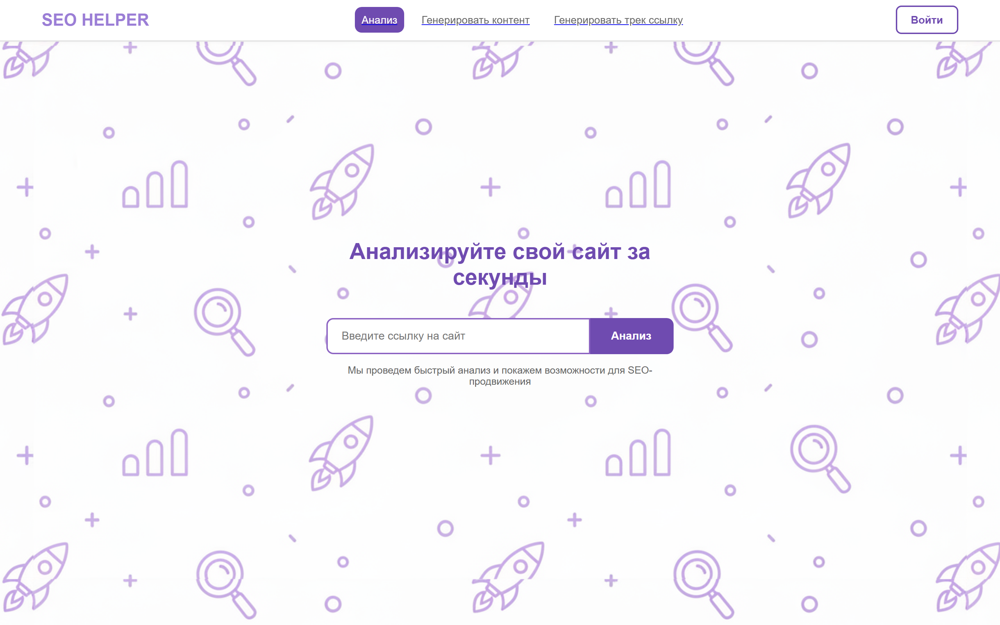
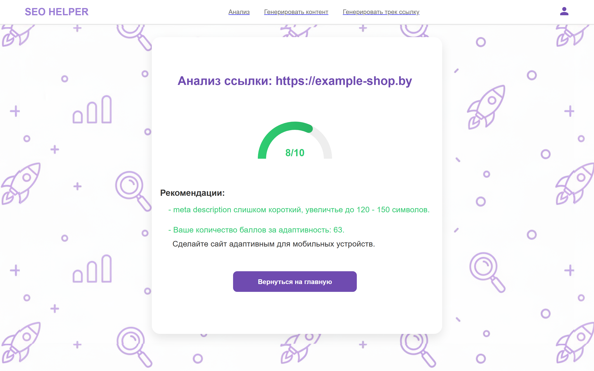
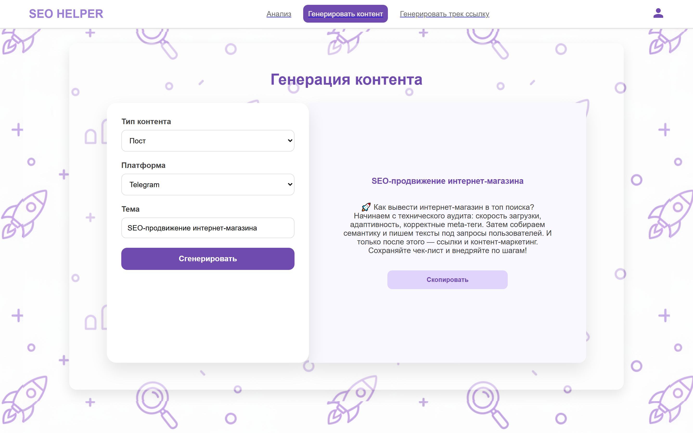
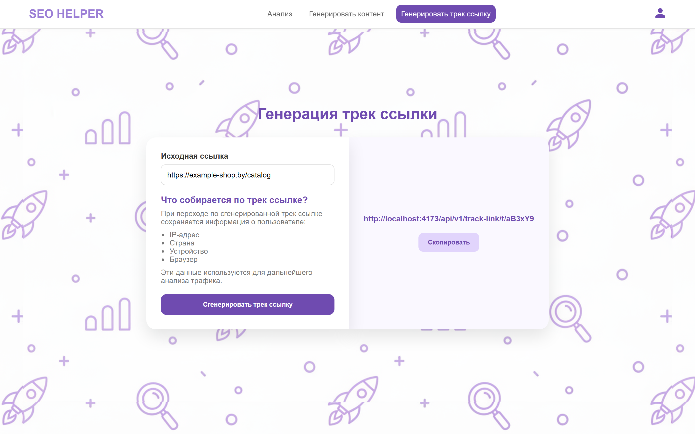
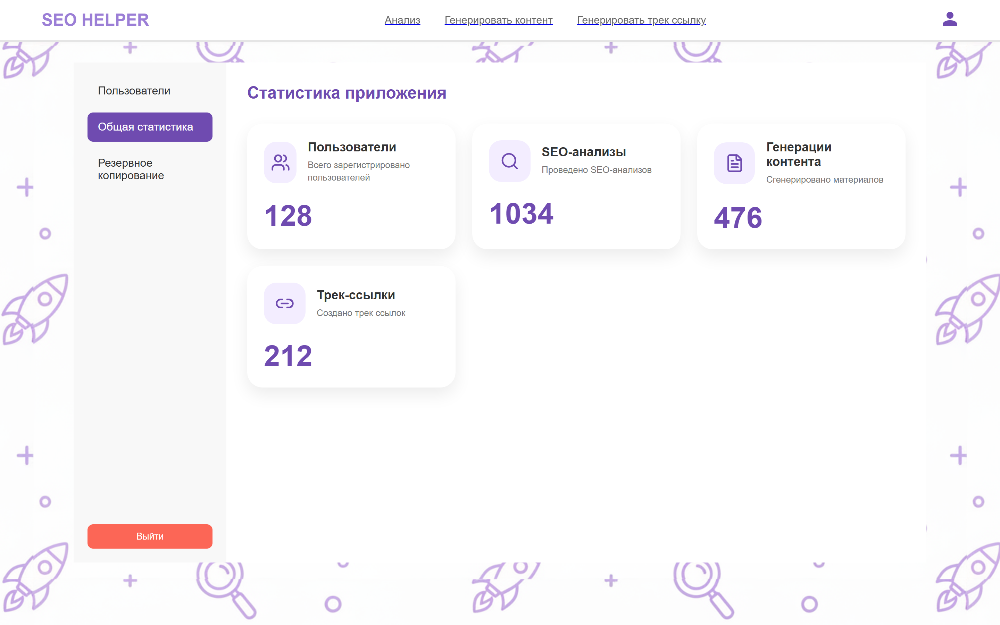
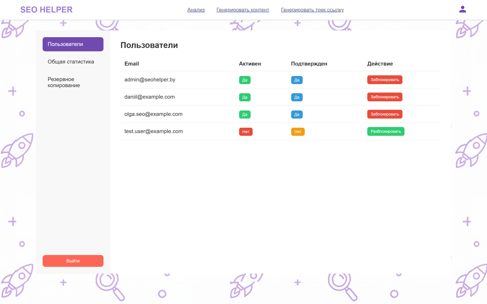
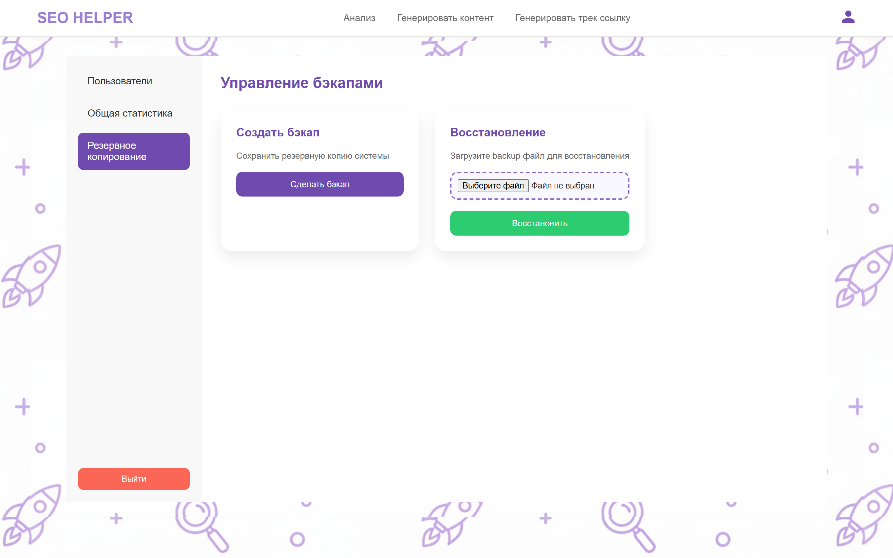
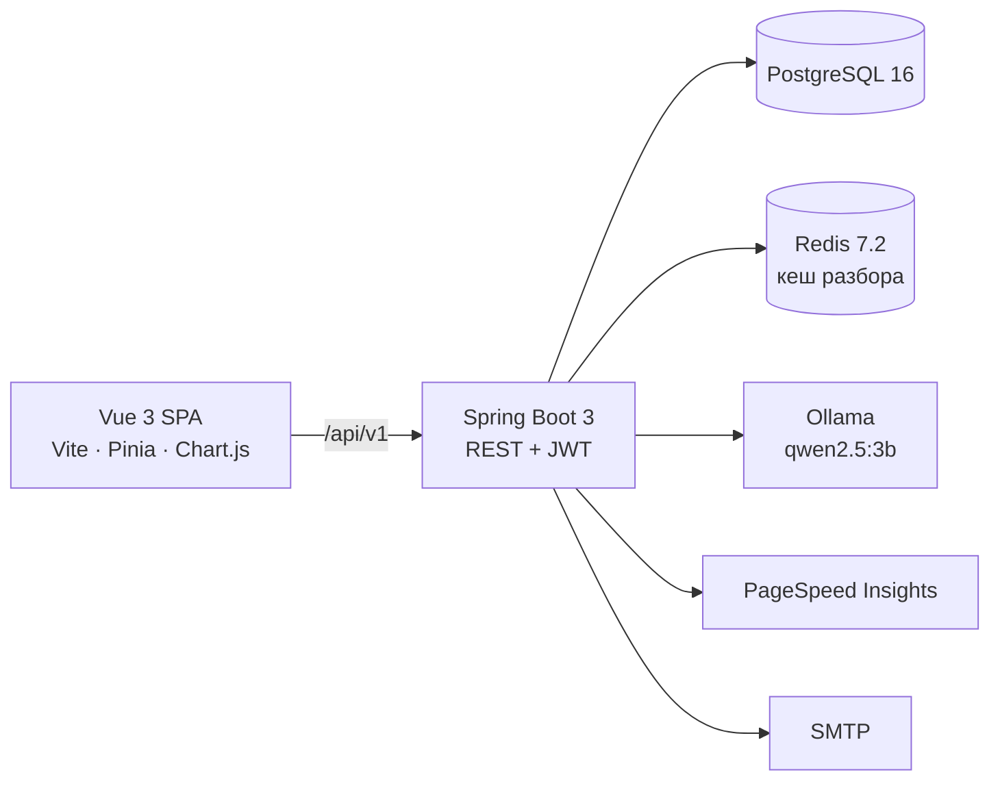

# SEO Helper

**Веб-платформа для SEO-аудита сайтов, генерации контента локальной LLM и аналитики переходов по коротким ссылкам.**

<p>
  
  
  
  
  
</p>



## Возможности

- **SEO-аудит** — разбор страницы через jsoup (meta, H1, HTTPS) и Google PageSpeed Insights; оценка 0–10 и рекомендации.
- **Генерация контента** — локальная модель Ollama `qwen2.5:3b` через Spring AI: описание сайта и посты для Telegram, Instagram, Blog, Threads.
- **Трек-ссылки** — короткие ссылки на Base62, сбор IP, браузера и устройства, графики Chart.js и экспорт в CSV.
- **Расписание** — регулярный аудит по cron-выражению, задачи восстанавливаются после перезапуска.
- **Аккаунты** — JWT, роли `ROLE_USER` / `ROLE_ADMIN`, подтверждение e-mail, сброс пароля.
- **Админка** — блокировка пользователей, сводная статистика, резервное копирование БД через `pg_dump` / `pg_restore`.

## Скриншоты

<p align="center">
  
  
  
  
</p>

<details>
<summary>Ещё скриншоты</summary>

<p align="center">
  
  
  
  
  
  
  
  
  
</p>

</details>

## Архитектура



## Стек

**Backend** — Java 17, Spring Boot 3.2, Spring Security (JWT), Spring Data JPA, Spring Data Redis, Spring AI, MapStruct, jsoup, Maven  
**Frontend** — Vue 3, Vite, Pinia, Vue Router, Axios, Chart.js  
**Инфраструктура** — PostgreSQL 16, Redis 7.2, Ollama, Docker Compose, nginx

## Быстрый старт

Нужен **Docker Desktop** (или Docker Engine + Compose v2).

```bash
git clone https://github.com/DaniilYemelyanenka/seohelper.git
cd seohelper

cp env/.env.example .env     # заполните CHANGE_ME_* (JWT_SECRET обязателен)

docker compose up --build -d
docker compose exec ollama ollama pull qwen2.5:3b
```

Приложение — на <http://localhost>, API — на `http://localhost:8080/api/v1`.

Для локального стенда и CI есть готовые безопасные значения:

```bash
cp env/.env.test .env
# или без копирования:
docker compose --env-file env/.env.test up --build -d
```

При первом старте `data.sql` создаёт пользователей `admin@example.com` (`ROLE_ADMIN`) и `user@example.com` (`ROLE_USER`). Пароли — bcrypt-хэши из сидов, для реального использования их нужно сменить.

## Переменные окружения

Секреты в коде не хранятся: все настройки приходят из окружения. Шаблоны и полный список переменных с инструкцией по генерации ключей — в [`env/`](env/README.md).

| Переменная | Обязательна | Назначение |
|---|---|---|
| `POSTGRES_DB` / `POSTGRES_USER` / `POSTGRES_PASSWORD` | да | База данных |
| `REDIS_PASSWORD` | да | Пароль Redis |
| `JWT_SECRET` | **да** | Секрет подписи JWT; без него backend не стартует |
| `PAGESPEED_API_KEY` | нет | Ключ PageSpeed Insights |
| `MAIL_HOST` / `MAIL_PORT` / `MAIL_USERNAME` / `MAIL_PASSWORD` | нет | SMTP для писем |
| `OLLAMA_MODEL` | нет | Модель Ollama, по умолчанию `qwen2.5:3b` |

`application.properties` содержит только подстановки `${...}`. Файл `.env` добавлен в `.gitignore`.

## Локальный запуск

**Backend** (JDK 17+, PostgreSQL и Redis):

```bash
cd backend
export SPRING_DATASOURCE_URL=jdbc:postgresql://localhost:5432/seohelper_db
export SPRING_DATASOURCE_USERNAME=seohelper
export SPRING_DATASOURCE_PASSWORD=seohelper_test_pg
export SPRING_DATA_REDIS_HOST=localhost
export SPRING_DATA_REDIS_PORT=6379
export SPRING_DATA_REDIS_PASSWORD=seohelper_test_redis
export OLLAMA_URL=http://localhost:11434
export DB_HOST=localhost
export JWT_SECRET="$(openssl rand -base64 48)"
./mvnw spring-boot:run
```

**Frontend** (Node.js 20+):

```bash
cd frontend
npm install
npm run dev
```

Axios обращается к относительному `/api/v1`, поэтому для dev-сервера нужен прокси в `vite.config.js`:

```js
server: {
  proxy: { '/api': { target: 'http://localhost:8080', changeOrigin: true } },
}
```

## API

Базовый префикс — `/api/v1`; защищённые методы требуют `Authorization: Bearer <JWT>`.

| Группа | Эндпоинты |
|---|---|
| Auth | `POST /auth/register` · `POST /auth/login` · `POST /auth/confirm-email` · `POST /auth/forgot-password` · `POST /auth/reset-password` |
| SEO | `POST /seo/analyze` · `GET /seo/history` · `GET /seo/{id}/analyze-information` · `DELETE /seo/delete/{id}` |
| Content | `POST /content/generate` · `GET /content/history` |
| Track links | `POST /track-link` · `GET /track-link/t/{code}` · `GET /track-link/links` · `GET /track-link/{code}/analyze` |
| Schedule | `GET /seo-schedule/tasks` · `POST /seo-schedule/add` · `DELETE /seo-schedule/delete/{id}` |
| Users / Admin | `GET /users/me` · `PUT /users/update` · `GET /admin/users` · `GET /admin/stats` · `PUT /admin/users/block` |
| Backup | `POST /backup/start` · `POST /backup/restore` |

## Безопасность

- JWT (HS256) и stateless-сессии, роли проверяются через `@PreAuthorize` и гард роутера.
- Аудит, генерация и трек-ссылки доступны только пользователям с подтверждённым e-mail.
- Пароли хранятся как BCrypt-хэши.
- Секреты задаются только через окружение, без `JWT_SECRET` приложение не стартует.
- ⚠️ Ключи из прошлых коммитов остаются в истории git — при использовании перевыпустите JWT-секрет, пароль SMTP и ключ PageSpeed (инструкция в [`env/README.md`](env/README.md)).

## Тесты

```bash
cd backend && ./mvnw test
```

Покрыты веб-слой и базовые сценарии SEO-анализа; интеграционные тесты с БД и Redis — в планах.

## Известные ограничения

- Страна посетителя в трек-ссылках определяется условно (`BY`) — нужен GeoIP.
- В `SecurityConfiguration` проверка `api/v1/admin/** → hasRole("ADMIN")` закомментирована, у `/backup/*` нет `@PreAuthorize` — перед публичным деплоем включите её.
- В `frontend/package.json` осталась опечатка-зависимость `pina`, из-за которой `npm ci` падает — удалите строку и используйте `npm install`.

## Лицензия

Лицензия не указана. Для использования в продакшене добавьте файл `LICENSE`.
